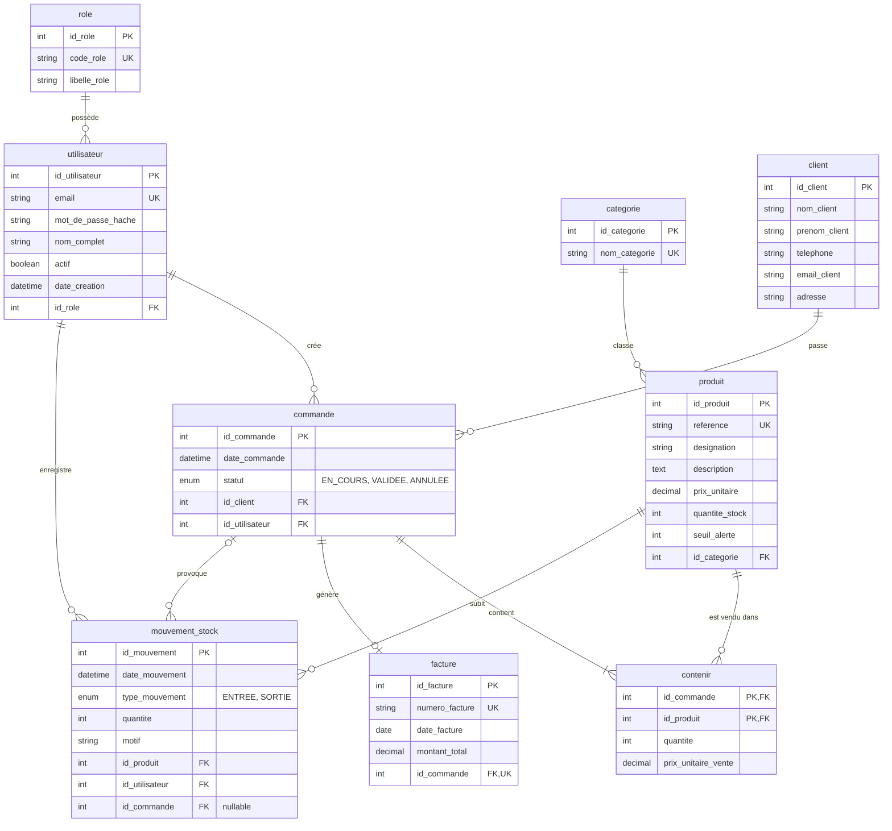

# MCD : Modèle conceptuel de données LogiStock SA

Ce schéma correspond exactement à `schema.sql` (tables et colonnes de l'équipe). Il s'affiche automatiquement sur GitHub grâce à Mermaid.

## Schéma

## Cardinalités (comment lire le schéma)

| Relation | Lecture |
|---|---|
| role → utilisateur | Un rôle est attribué à plusieurs utilisateurs ; un utilisateur a un seul rôle |
| categorie → produit | Une catégorie contient plusieurs produits ; un produit a une seule catégorie |
| client → commande | Un client passe plusieurs commandes ; une commande concerne un seul client |
| utilisateur → commande | Un commercial crée plusieurs commandes |
| commande ↔ produit (table `contenir`) | Une commande contient au moins un produit ; un produit peut figurer dans plusieurs commandes. La table `contenir` porte la quantité et le prix de vente |
| commande → facture | Une commande a au plus une facture (0 ou 1) |
| produit → mouvement_stock | Un produit a plusieurs mouvements (entrées et sorties) |
| utilisateur → mouvement_stock | Un utilisateur enregistre plusieurs mouvements |
| commande → mouvement_stock | Une commande peut provoquer plusieurs mouvements de SORTIE ; un mouvement n'a pas forcément de commande (ex. entrée de stock : `id_commande` est NULL) |

## Règles de gestion

1. Un utilisateur n'accède à l'application qu'avec une authentification valide, et n'utilise que les fonctions de son rôle (`ADMINISTRATEUR`, `GESTIONNAIRE_STOCK`, `COMMERCIAL`).
2. La quantité en stock d'un produit ne peut jamais être négative (contrainte `quantite_stock >= 0`).
3. Toute entrée ou sortie de stock est enregistrée dans `mouvement_stock` avec la date, l'heure et l'utilisateur.
4. Une alerte s'affiche quand `quantite_stock` est inférieure ou égale à `seuil_alerte`.
5. Le prix de vente est copié dans `contenir.prix_unitaire_vente` : si le prix du produit change plus tard, les anciennes ventes ne changent pas.
6. Le total d'une commande n'est pas stocké : il se calcule par la somme de `quantite × prix_unitaire_vente` de ses lignes.
7. La validation d'une commande (statut `VALIDEE`) diminue le stock et crée un mouvement de SORTIE par ligne, rattaché à la commande. Elle est refusée si le stock d'un produit est insuffisant.
8. Une facture n'existe que pour une commande validée ; son `montant_total` est figé à la création.
