# MCD : Modèle conceptuel de données LogiStock SA

Ce schéma correspond à `schema.sql` (le MLD). Il s'affiche automatiquement sur GitHub grâce à Mermaid.

## Schéma

```mermaid
erDiagram
    ROLES ||--o{ USERS : "est attribué à"
    CATEGORIES ||--o{ PRODUCTS : "classe"
    PRODUCTS ||--o{ STOCK_MOVEMENTS : "subit"
    USERS ||--o{ STOCK_MOVEMENTS : "enregistre"
    CLIENTS ||--o{ ORDERS : "passe"
    USERS ||--o{ ORDERS : "crée"
    ORDERS ||--|{ ORDER_LINES : "contient"
    PRODUCTS ||--o{ ORDER_LINES : "est vendu dans"
    ORDERS ||--o| INVOICES : "génère"

    ROLES {
        int id PK
        enum nom "ADMIN, GESTIONNAIRE_STOCK, COMMERCIAL"
    }
    USERS {
        int id PK
        string nom
        string email UK
        string mot_de_passe_hash
        int role_id FK
        boolean actif
    }
    CATEGORIES {
        int id PK
        string nom UK
    }
    PRODUCTS {
        int id PK
        string reference UK
        string designation
        text description
        decimal prix
        int quantite
        int seuil_alerte
        int category_id FK
    }
    STOCK_MOVEMENTS {
        int id PK
        int product_id FK
        int user_id FK
        enum type "ENTREE, SORTIE"
        int quantite
        string motif
        timestamp date_mouvement
    }
    CLIENTS {
        int id PK
        string nom
        string telephone
        string email
        string adresse
    }
    ORDERS {
        int id PK
        int client_id FK
        int user_id FK
        enum statut "BROUILLON, VALIDEE, ANNULEE"
        decimal total
        timestamp date_commande
    }
    ORDER_LINES {
        int id PK
        int order_id FK
        int product_id FK
        int quantite
        decimal prix_unitaire
    }
    INVOICES {
        int id PK
        int order_id FK
        string numero UK
        timestamp date_facture
        string chemin_pdf
    }
```

## Cardinalités (comment lire le schéma)

| Relation | Lecture |
|---|---|
| Rôle → Utilisateur | Un rôle est attribué à plusieurs utilisateurs ; un utilisateur a un seul rôle |
| Catégorie → Produit | Une catégorie contient plusieurs produits ; un produit a une seule catégorie |
| Produit → Mouvement | Un produit a plusieurs mouvements de stock (entrées et sorties) |
| Utilisateur → Mouvement | Un utilisateur enregistre plusieurs mouvements |
| Client → Commande | Un client passe plusieurs commandes |
| Utilisateur → Commande | Un commercial crée plusieurs commandes |
| Commande → Ligne | Une commande a au moins une ligne ; chaque ligne concerne un produit |
| Commande → Facture | Une commande validée a une seule facture (0 ou 1) |

## Règles de gestion

1. Un utilisateur ne peut accéder à l'application qu'avec une authentification valide et n'utilise que les fonctions de son rôle.
2. La quantité en stock d'un produit ne peut jamais être négative.
3. Toute entrée ou sortie de stock est enregistrée avec la date, l'heure et l'utilisateur.
4. Une alerte s'affiche quand la quantité d'un produit est inférieure ou égale à son seuil.
5. Le prix de vente est copié dans la ligne de commande (`prix_unitaire`) : si le prix du produit change plus tard, les anciennes ventes ne changent pas.
6. La validation d'une commande diminue le stock et crée un mouvement de SORTIE par ligne. Elle est refusée si le stock d'un produit est insuffisant.
7. Une facture n'existe que pour une commande validée.
